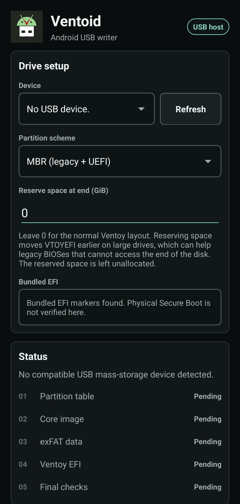
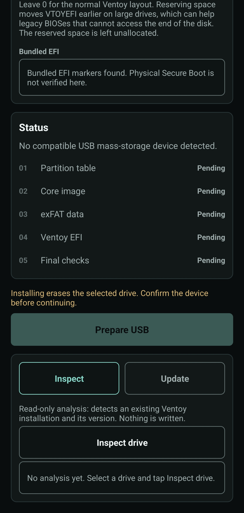

# Ventoid

[](https://f-droid.org/packages/com.ventoid.app/)
[](https://github.com/GPLaider/Ventoid/releases/latest)
[](LICENSE)
[](https://github.com/GPLaider/Ventoid/actions/workflows/android-verify.yml)


Ventoid turns an Android phone into a practical Ventoy-style USB preparation tool. Plug in a USB drive over OTG, choose a layout, and prepare bootable USB media without needing a working PC. The bundled payload is the checksum-verified Ventoy 1.1.18 release.

It is built for offline Android OTG workflows, released on F-Droid, licensed as `GPL-3.0-only`, and includes no ads, no analytics, and no network dependency for normal use.

For the difference between tagged releases and development changes, see the
[changelog](CHANGELOG.md). Upcoming work and remaining release checks are tracked
in the [roadmap](ROADMAP.md).

| Drive setup and progress | Inspect and update |
| --- | --- |
|  |  |

## What Ventoid is for

- Emergency repair kits
- Linux installation USBs
- Recovery USB preparation
- Situations where a phone is the only working device
- Users who want a GPL-compliant, offline, ad-free USB preparation tool

## Quick Start

1. Install Ventoid from [F-Droid](https://f-droid.org/packages/com.ventoid.app/) or [GitHub Releases](https://github.com/GPLaider/Ventoid/releases/latest).
2. Connect a USB drive using Android OTG.
3. Open Ventoid and grant USB permission.
4. Select the target USB device carefully.
5. Choose MBR or GPT layout.
6. Start USB preparation.
   Check the device name, capacity, partition scheme, and reserved space in the
   erase confirmation before proceeding. Use Update or Repair to preserve an
   existing Ventoy data partition.
7. After Ventoid prepares the drive, remount it if needed, then copy ISO files to the exFAT data partition with Android Files or another file manager.

Ventoid writes to the selected USB drive. This can erase or overwrite existing data. Back up anything important first.

## What Ventoid is not

- Ventoid is not the official Ventoy Android app.
- Ventoid is an independent GPL-licensed Android project that prepares Ventoy-style USB media.
- It does not require root.
- It does not download ISO files for you.
- It does not guarantee that every phone, USB drive, hub, or firmware will behave the same way.

## Compatibility Notes

- Requires Android USB host / OTG support.
- Requires a USB mass-storage device visible to Android.
- Some phones, USB-C hubs, card readers, or flash drives may behave differently.
- Large ISO files require the exFAT data partition.
- Bundled media includes the Ventoy Secure Boot chain; first boot on a Secure Boot PC may require a one-time MOK enrollment of the Ventoy certificate.
- Boot success still depends on the target computer firmware, Secure Boot settings, MOK enrollment, and ISO compatibility.

## Troubleshooting

### No USB device is detected

- Confirm that the Android device supports USB host / OTG mode.
- Reconnect the drive after opening Ventoid and grant the USB permission prompt.
- If the drive disconnects or repeatedly disappears, try a direct OTG adapter, a powered hub, or another USB port or drive.

### Sharing a diagnostic report

Open **Diagnostics**, review the device details and recent log, then choose
**Save report** or **Share report**. Reports include the app version, Android/phone
model, selected USB device, operation and status, available drive analysis, and
up to 64 KiB of recent log text. Sharing happens only when you choose a target.
The app also includes offline **USB and first-boot help**, including ISO copying
and the bundled Ventoy MOK certificate enrollment path.

### The exFAT data partition is not visible after preparation

Remount or physically reconnect the drive after Ventoid finishes. Android should then expose the exFAT data partition so ISO files can be copied with Android Files or another file manager.

### The drive appears read-only

Ventoid does not enable hardware or operating-system write protection. Check for a physical lock switch, reconnect the drive, and inspect the host operating system's disk attributes before preparing it again.

### A PC reports error 4098 or a missing `ventoy/ventoy.cpio`

This indicates that the expected Ventoy payload is missing from the prepared VTOYEFI partition. Prepare the drive again with the latest Ventoid release without disconnecting it during the write. If the error repeats, include the exact message, phone, OTG adapter or hub, drive model, capacity, and Ventoid log in a [bug report](https://github.com/GPLaider/Ventoid/issues/new?template=bug_report.yml).

### A very large drive fails to prepare

Drives larger than 2TB are supported: Ventoid resolves their capacity with SCSI READ CAPACITY(16) and uses 16-byte read/write commands for sectors past the 32-bit boundary. Choose the GPT layout for these drives, since MBR partition tables cannot describe LBAs beyond 32 bits. If preparation still fails, report the exact drive size, bridge or enclosure model, and error text rather than retrying destructive writes.

Successful and failed hardware combinations can be submitted with the [device compatibility form](https://github.com/GPLaider/Ventoid/issues/new?template=device_compatibility.yml).

## Features

### USB preparation

- Prepare bootable USB media without a PC
- Write directly to USB mass-storage devices over Android OTG
- Inspect a connected drive read-only: detect an existing Ventoy layout, read its
  installed version, and see whether the bundled Ventoy is newer
- Update Ventoy on a prepared drive without erasing it: rewrite only the boot
  files and VTOYEFI payload while the data partition keeps every ISO
- Repair a matching Ventoy version in place; block updates that would downgrade
  a newer installed version
- List image names and free space on exFAT data partitions, including warnings
  for zero-byte images; the expanded list shows up to 100 names
- Choose MBR or GPT Ventoy-compatible disk layouts
- Write the Ventoy core image and EFI partition image
- Format the data partition as exFAT for large ISO files

### Safety and transparency

- Ship the Ventoy x86_64 Secure Boot chain (Rocky-signed shim + MOK manager) with pinned provenance
- Verify bundled Secure Boot markers before writing
- Validate reserved space before writing, sample written core/EFI sectors for
  readback verification, and re-analyse the drive after installation
- Show transfer speed and estimated remaining time while writing VTOYEFI
- Keep one USB operation and its progress across screen rotation and app
  switching using a foreground service and progress notification. Notification
  permission can be declined; operations still work. Force-stop, process death,
  and unplugging the drive do not automatically resume a write.
- Lock USB/layout controls during an operation, confirm destructive preparation,
  and detect USB attachment and removal automatically
- Preview, save, or share a diagnostic report with a bounded recent log
- Korean and Chinese UI, with offline USB and first-boot help
- Keep five stable progress rows for the partition table, core image, exFAT data,
  Ventoy EFI, and final checks, with progress shown directly on the install action
- No ads
- No analytics
- No network dependency
- `GPL-3.0-only` source code

Image listing identifies supported filename extensions; it does not prove that
an image boots. Sampled readback can miss damage between samples. QEMU checks
reach the Ventoy 1.1.18 menu under both BIOS and UEFI for fresh and updated
MBR/GPT layouts; ISO guest boots, Secure Boot enforcement, and physical Android
OTG workflows still need separate verification.

The 0.4.1 UI and operation-lifetime changes above are available in development
until a corresponding release is tagged; see the changelog for release status.

## Install

The recommended install path is F-Droid:

- https://f-droid.org/packages/com.ventoid.app/

GitHub APKs are also attached to tagged releases:

- https://github.com/GPLaider/Ventoid/releases/latest

### GitHub APK signing note

Ventoid 0.1.7 and later GitHub APKs use a new GitHub release signing key. If you installed an older GitHub APK, Android may reject an in-place update. Uninstall the older GitHub APK first, then install the latest release, or switch to the F-Droid build.

F-Droid builds are unaffected because F-Droid builds from source and signs packages with its own repository key.

## Privacy

Ventoid is designed to work offline. It does not include ads, analytics, tracking SDKs, or network-dependent behavior.

## Relationship to Ventoy

Ventoid focuses on Android OTG workflows for preparing Ventoy-style USB media from a phone. Ventoy itself remains the original bootable USB project. This project is independent and aims to provide a clean, GPL-compliant Android implementation for mobile USB preparation.

## Project Info

- Package: `com.ventoid.app`
- Module: `app`
- Minimum Android SDK: 21
- Target Android SDK: 35
- License: `GPL-3.0-only`

## Key Source Files

- `app/src/main/java/com/ventoid/app/MainActivity.kt`
- `app/src/main/java/com/ventoid/app/install/VentoyInstallCoordinator.kt`
- `app/src/main/java/com/ventoid/app/installer/VentoyInstaller.kt`
- `app/src/main/java/com/ventoid/app/installer/ExFatFormatter.kt`
- `app/src/main/java/com/ventoid/app/usb/UsbMassStorageHelper.kt`

## Bundled Assets

- `app/src/main/assets/boot/boot.img`
- `app/src/main/assets/boot/core.img`
- `app/src/main/assets/ventoy/ventoy.disk.img`

Ventoid keeps these assets in the repository so the Android project can be built and reviewed without downloading extra binary payloads during the app build.

## Build From Source

Ventoid should be verifiable by anyone. You can open the project in Android Studio or build it directly with Gradle from the repository root.

### Android Studio

1. Clone the repository.
2. Open the project in Android Studio.
3. Let Gradle sync and install any missing Android SDK components.
4. Build a debug APK from **Build > Build Bundle(s) / APK(s) > Build APK(s)**, or run the app on a device with USB debugging enabled.

### Command Line

On Windows, run these commands from the repository root:

```powershell
.\gradlew.bat :app:testDebugUnitTest
.\gradlew.bat :app:assembleDebug
```

For a release build on Windows:

```powershell
.\gradlew.bat :app:assembleRelease
```

On Linux or macOS:

```bash
./gradlew :app:testDebugUnitTest
./gradlew :app:assembleDebug
```

For a release build on Linux or macOS:

```bash
./gradlew :app:assembleRelease
```

Release signing is optional. If no `VENTOID_RELEASE_*` environment variables or Gradle properties are set, Gradle generates an unsigned release APK.

To obtain a signed test build without publishing a release, run the
**GitHub Release APK** workflow manually with `publish` disabled. Leaving
`tag` empty builds the selected branch and retains the signed APK/AAB as a
private Actions artifact for seven days. Tag pushes keep the public release
behavior.

## Release Preflight

Before pushing a new F-Droid metadata update, run the local preflight from the repository root:

```powershell
pwsh -File .\scripts\Test-FdroidPreflight.ps1 -UpdateMetadata
```

The preflight keeps the bundled `fdroiddata/metadata/com.ventoid.app.yml` copy aligned with the current app version, then runs:

- `:app:lintRelease`
- `:app:testDebugUnitTest`
- `:app:assembleRelease`
- `:app:bundleRelease`

GitHub Actions runs Android verification on pushes and pull requests, plus an F-Droid preflight job on `v*` tags and manual dispatches.
